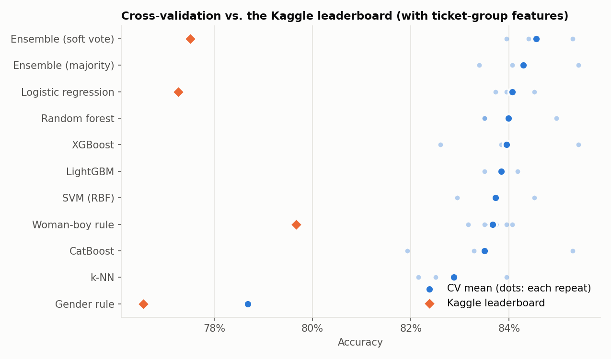
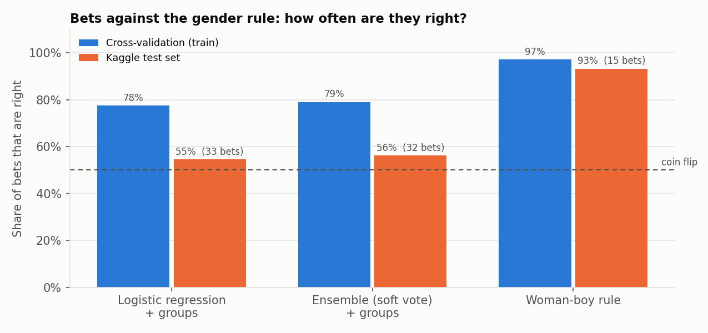
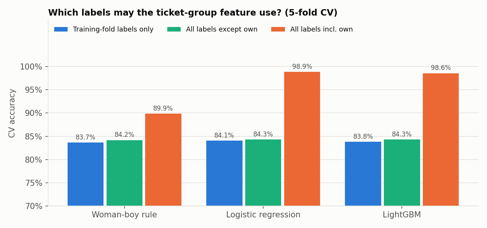
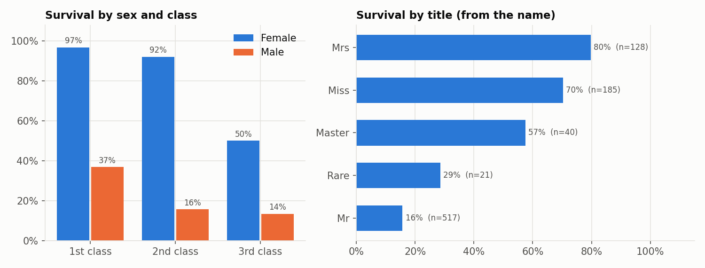

**English** | [Español](README.es.md)

# Titanic: why a two-line rule beats seven tuned models on the leaderboard


The Kaggle getting-started competition
[Titanic - Machine Learning from Disaster](https://www.kaggle.com/competitions/titanic):
891 passengers with a known outcome, 418 to predict, scored by accuracy.

I took it through the full competition workflow (EDA, feature engineering, seven model
families with nested cross-validation, two ensembles, submissions) and then asked
the question the leaderboard forces on you: **why do models that score 84% in
cross-validation land at 77% on the test set, while a simple rule holds up?**

**Best Kaggle score: 0.79904** (334 of 418 passengers) with the woman-boy rule grouped by
family. The best machine-learning submission scored 0.77511.

**Project page:** https://rxyxs.github.io/titanic-survival-kaggle/

## Results

Cross-validation is nested (outer 5-fold x 3 repeats, inner 5-fold grid search), so the
tuning never sees the fold it is scored on. Rules use 5-fold x 10 repeats. Kaggle scores
every submission on all 418 test passengers (each score is a multiple of 1/418), so
**one passenger is 0.24 points**.

| Submission | CV accuracy | Kaggle |
|---|---|---|
| Gender rule (women survive, men die) | 0.787 | 0.76555 |
| **Woman-boy rule, family groups** (chosen by CV, see finding 5) | 0.840 | **0.79904** |
| Woman-boy rule, ticket groups | 0.837 | 0.79665 |
| Ensemble, soft vote of 7 models + ticket-group features | 0.846 | 0.77511 |
| Logistic regression + ticket-group features | 0.841 | 0.77272 |
| Ensemble, soft vote of 7 models, no group features | 0.835 | 0.76794 |
| XGBoost, no group features (best single model without groups) | 0.837 | 0.76076 |
| LightGBM with a leaking group feature | 0.986 | 0.64114 |



**1. Every model's bets against the gender rule collapse to a coin flip on the test set.**
Sex alone explains most of the outcome (74% of women and 19% of men survived). So a model
is effectively the gender rule plus a few dozen *bets*: a man predicted to survive, or a
woman predicted to die. Because the gender rule was also submitted, the value of those bets
on the test set follows from the two scores, with no test labels needed:
`net correct bets = (score - gender score) x 418`.

| | Bets in CV (per 418) | Right in CV | Bets on test | Right on test |
|---|---|---|---|---|
| Logistic regression + groups | 40 | 78% | 33 | 55% (18 of 33) |
| Ensemble + groups | 40 | 79% | 32 | 56% (18 of 32) |
| Woman-boy rule, ticket groups | 22 | 97% | 15 | **93% (14 of 15)** |
| Woman-boy rule, family groups | 23 | 98% | 16 | **94% (15 of 16)** |



The models' bets come from patterns (first-class men, large third-class families) that fit
the 891 training passengers and do not carry over. The rule bets only when there is direct
evidence: a woman whose woman-and-boy ticket mates all died, or a boy whose woman-and-boy
ticket mates all survived. Those bets keep their accuracy. With 32 bets the test precision is
uncertain (roughly +/-17 points at 95%), but 78% is outside that range, and the rule's 14
of 15 is not.

**2. The CV-to-leaderboard gap is not all overfitting.** The gender rule has nothing to fit
and still drops two points (0.787 to 0.766), which is one standard error on 418 passengers.
The models drop six to seven points, so about four of those points are bets that do not
generalize. Tuning optimism is small by comparison: the inner grid-search score beats the
outer score by at most 1.0 point (0.5 on average).

**3. Ticket-group survival is the only feature that pays off on the leaderboard, and it
leaks if computed carelessly.** 596 of the 1,309 passengers travel on one of 216 shared
tickets, and 152 test passengers share a ticket with someone in the training set. Each passenger's feature is the survival
rate of their ticket mates. Which labels it may use decides what CV reports:



| Labels the group feature may use | Logistic regression CV | LightGBM CV |
|---|---|---|
| Training fold only (what the test set gets) | 0.841 | 0.838 |
| Every train label except the passenger's own | 0.843 | 0.843 |
| Every train label including the passenger's own | 0.989 | 0.986 |

Including the passenger's own label is an obvious leak in code review and a catastrophic
one in practice: on a passenger travelling alone the feature *is* the answer. The model
learns to trust it, and on the test set it predicts 57% survival and scores 0.641, worse
than predicting by sex. The subtler leak (mates' labels from the validation fold) inflates
CV by only 0.2 to 0.5 points. Measuring it is the only way to know it is small.

**4. With 891 passengers, model choice is noise.** Fold-to-fold standard deviation is about
2 points, and the same model moves up to 2.8 points between repeats of 5-fold CV
(XGBoost: 0.826 to 0.854). All seven tuned families with group features land between 0.829
and 0.841, and the ensemble (0.846) is within one fold standard deviation of the best single
model. On the leaderboard the soft-vote ensemble beats logistic regression by exactly one
passenger.

**5. Grouping by family instead of ticket helps the rule a little, and CV says so before
the leaderboard does.** A ticket links travel companions who are not family (nannies,
friends) and splits families who bought separate tickets. I compared three groupings on the
same 100 folds (5-fold x 20 repeats):

| Group = | Rule CV | vs ticket | Repeats better | Bet precision (CV) |
|---|---|---|---|---|
| Same ticket | 0.836 | | | 97.3% |
| **Same family**: surname + class + ticket without last digit + fare + port | **0.840** | +0.39 | 20 of 20 | 98.0% |
| Linked by either (connected components) | 0.840 | +0.33 | 20 of 20 | 97.5% |

The family grouping was chosen on CV alone and submitted once. It changes 3 of the 418 test
predictions; Kaggle went from 0.79665 to 0.79904, one more passenger right (16 bets on the
test set, 15 right). That agrees with CV in direction, and one passenger is well inside the
noise, so the honest reading is "slightly better, not proven better".

## Approach

Following the competition's own steps: accept rules, download, understand, EDA, train,
tune and ensemble, submit.

- **EDA** ([`reports/eda.json`](reports/eda.json)): survival 38.4%; women 74% vs men 19%;
  97% of first-class women survive vs 50% in third class; titles from the name separate
  boys (Master, 57%) from men (Mr, 16%). Age is missing for 263 of 1,309 passengers and the
  cabin for 1,014.



- **Features** ([`src/titanic/features.py`](src/titanic/features.py)): title, sex, class,
  age imputed by the median of title x class, missing-age flag, family size, alone flag,
  passengers per ticket, log fare and log fare per person, deck from the cabin letter,
  port. These use only passenger attributes, computed on train and test together.
  **Ticket-group features** use labels and are recomputed inside every fold from the
  training fold only.
- **Models** ([`src/titanic/models.py`](src/titanic/models.py)): logistic regression, RBF
  SVM, k-NN, random forest, LightGBM, XGBoost and CatBoost, each with a small grid; a soft-vote
  and a majority-vote ensemble over all seven, with membership fixed in advance so the
  ensemble is scored by the same nested CV.
- **Woman-boy rule**: the woman-child-group idea that circulates in the competition's public
  notebooks, kept to two corrections of the gender rule.
- **Bets analysis** ([`src/titanic/bets.py`](src/titanic/bets.py)): bet counts and precision
  in out-of-fold predictions vs. those implied by the public scores.

No leaderboard feedback was used to choose a model: the first seven files were generated by
one pipeline run before anything was submitted, and were submitted together. The eighth
(family groups) was picked by CV among three groupings and submitted once.

## Data

[Titanic - Machine Learning from Disaster](https://www.kaggle.com/competitions/titanic),
Kaggle (Will Cukierski, 2012). Downloaded October 2026 with the Kaggle API under the
competition rules (competition, academic and non-commercial use); the data is not in this
repository. `submissions/` holds my prediction files.

## Reproduce

```powershell
python -m venv venv
.\venv\Scripts\python.exe -m pip install -r requirements.txt
$env:PYTHONPATH = "src"
python -m titanic.data       # download (needs ~/.kaggle/kaggle.json and accepted rules)
python -m titanic.run        # EDA, baselines, nested CV, leak study, submissions (~5 min)
python -m titanic.submit gender woman_boy_rule xgboost_base ensemble_soft_base logreg_group ensemble_soft_group lightgbm_leaky
python -m titanic.rule_groups  # ticket vs family vs union groups for the rule, picks by CV
python -m titanic.submit woman_boy_rule_family
python -m titanic.bets       # bets: CV vs leaderboard
python -m titanic.figures '{\"gender\":\"gender\",\"rule_honest\":\"woman_boy_rule\",\"logreg\":\"logreg_group\",\"ensemble_soft\":\"ensemble_soft_group\"}'
pytest -q tests
```

## Project layout

```
src/titanic/  data.py      download and load
              features.py  passenger features, ticket-group features, woman-boy rule
              models.py    model zoo, nested CV, final fits
              run.py       pipeline
              submit.py    Kaggle CLI submission and scores
              rule_groups.py  group definitions for the rule, chosen by CV
              bets.py      bet precision, CV vs leaderboard
              figures.py   figures
reports/      every number in this README (JSON)
submissions/  the eight submitted files
tests/        feature and fold-isolation tests
```

## Limitations

- 418 test passengers make every leaderboard difference below about four points
  statistically fragile; the bet analysis is about the direction of the gap, not its
  exact size.
- The hyperparameter grids are small on purpose; bigger searches were not tried because
  CV cannot rank the models anyway.
- Kaggle's public score here covers the whole test set, so there is no separate private
  score to check against.

## License

Code: MIT. Data: Kaggle competition rules (not redistributed).
